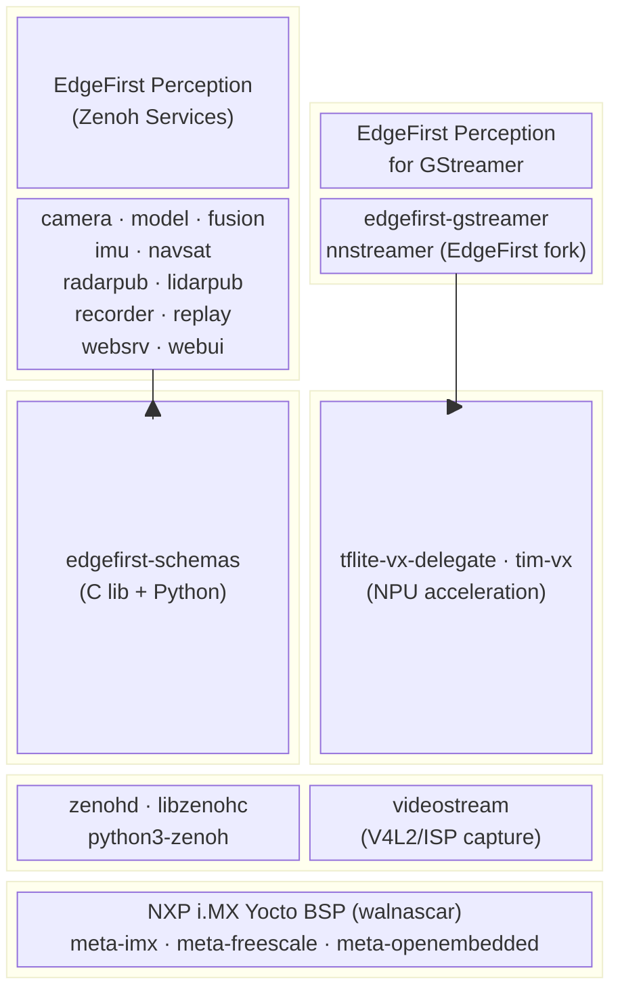

# meta-edgefirst

Yocto layer for the **EdgeFirst Perception Platform** targeting NXP i.MX processors.

meta-edgefirst provides the complete EdgeFirst ecosystem for embedded perception: Zenoh-based sensor services, NNStreamer/GStreamer ML inference pipelines, NPU-accelerated model execution, and supporting infrastructure. It is designed to work with the NXP i.MX Yocto BSP (walnascar release) and brings multi-sensor AI perception to i.MX8M Plus and i.MX93 platforms.

## Architecture



## Recipe Groups

### recipes-perception — Zenoh-Based Sensor Services

Standalone Zenoh-native services that publish, record, and replay sensor data. Each service runs as a systemd unit and communicates over the Zenoh protocol using EdgeFirst Schemas for message serialization.

| Recipe | GitHub Repository | Description |
|--------|-------------------|-------------|
| `edgefirst-camera` | [EdgeFirstAI/camera](https://github.com/EdgeFirstAI/camera) | Camera capture service — V4L2/ISP acquisition, Zenoh image publishing |
| `edgefirst-model` | [EdgeFirstAI/model](https://github.com/EdgeFirstAI/model) | Model inference service — NPU-accelerated object detection and classification |
| `edgefirst-fusion` | [EdgeFirstAI/fusion](https://github.com/EdgeFirstAI/fusion) | Sensor fusion service — radar-camera BEV fusion and occupancy grid |
| `edgefirst-imu` | [EdgeFirstAI/imu](https://github.com/EdgeFirstAI/imu) | IMU service — accelerometer/gyroscope data from I2C/SPI sensors |
| `edgefirst-navsat` | [EdgeFirstAI/navsat](https://github.com/EdgeFirstAI/navsat) | GNSS/GPS navigation satellite receiver service |
| `edgefirst-radarpub` | [EdgeFirstAI/radarpub](https://github.com/EdgeFirstAI/radarpub) | Radar publisher — automotive radar sensor data over Zenoh |
| `edgefirst-lidarpub` | [EdgeFirstAI/lidarpub](https://github.com/EdgeFirstAI/lidarpub) | LiDAR publisher — point cloud data from LiDAR sensors |
| `edgefirst-recorder` | [EdgeFirstAI/recorder](https://github.com/EdgeFirstAI/recorder) | Session recorder — captures Zenoh streams to disk for replay |
| `edgefirst-replay` | [EdgeFirstAI/replay](https://github.com/EdgeFirstAI/replay) | Session replay — replays recorded Zenoh sessions |
| `edgefirst-websrv` | [EdgeFirstAI/websrv](https://github.com/EdgeFirstAI/websrv) | Web UI backend server for EdgeFirst services |
| `edgefirst-webui` | [EdgeFirstAI/webui](https://github.com/EdgeFirstAI/webui) | Web dashboard for monitoring and configuring EdgeFirst services |
| `edgefirst-hal` | [EdgeFirstAI/hal](https://github.com/EdgeFirstAI/hal) | Hardware abstraction layer (C library + Python bindings) |
| `edgefirst-camera-libcamera` | [EdgeFirstAI/camera](https://github.com/EdgeFirstAI/camera) | libcamera shim the EdgeFirst Camera SDK loads at run time, built against the image's libcamera (0.5 or newer); not pulled in by a shared library dependency, so whatever ships the SDK installs it |
| `edgefirst-ara2` | [EdgeFirstAI/ara2-rs](https://github.com/EdgeFirstAI/ara2-rs) | Ara-2 NPU Python bindings; work with either `imx-nxp-ara2` runtime packaging (NXP's meta-imx-ml or the Kinara SDK from meta-kinara), which must be in the build |
| `edgefirst-schemas` | [EdgeFirstAI/schemas](https://github.com/EdgeFirstAI/schemas) | Shared schema library (C + Python) for EdgeFirst message types |

### recipes-nnstreamer — ML Inference Pipelines

GStreamer/NNStreamer plugins for real-time ML inference on video and sensor streams.

| Recipe | GitHub Repository | Description |
|--------|-------------------|-------------|
| `edgefirst-gstreamer` | [EdgeFirstAI/gstreamer](https://github.com/EdgeFirstAI/gstreamer) | EdgeFirst Perception for GStreamer — Zenoh bridge elements, sensor fusion processing, HAL camera adaptor |
| `nnstreamer` | [EdgeFirstAI/nnstreamer](https://github.com/EdgeFirstAI/nnstreamer) | EdgeFirst fork of NNStreamer — adds dmabuf zero-copy, TFLite-VX CameraAdaptor, Ara-2 sub-filter support (built only with meta-kinara's Kinara SDK runtime, `KINARA_ARA2_RUNTIME = "kinara"`) |

### recipes-extensions — NPU Acceleration Libraries

Bbappend files for NXP ML libraries, pulling EdgeFirstAI forks with optimizations and fixes for the i.MX NPU (Neural Processing Unit).

| Recipe | GitHub Repository | Description |
|--------|-------------------|-------------|
| `tim-vx` | [EdgeFirstAI/tim-vx](https://github.com/EdgeFirstAI/tim-vx) | Tensor Interface Module for OpenVX — NPU graph compiler interface |
| `tflite-vx-delegate` | [EdgeFirstAI/tflite-vx-delegate](https://github.com/EdgeFirstAI/tflite-vx-delegate) | TFLite delegate for VeriSilicon NPU — routes TFLite operations to the NPU via TIM-VX |

### recipes-support — Supporting Infrastructure

Core infrastructure services and libraries required by the perception and GStreamer stacks.

| Recipe | GitHub Repository | Description |
|--------|-------------------|-------------|
| `zenoh` | [eclipse-zenoh/zenoh](https://github.com/eclipse-zenoh/zenoh) | Zenoh router daemon (zenohd), libzenohc, and python3-zenoh bindings |
| `videostream` | [EdgeFirstAI/videostream](https://github.com/EdgeFirstAI/videostream) | V4L2/ISP video capture library with DMA-BUF support for zero-copy pipelines |
| `pseudo` | [pseudo](https://git.yoctoproject.org/pseudo) | Walnascar only: moved to 1.9.8 so builds work on hosts whose `tar` uses `openat2()` (bbappend in `recipes-devtools/`) |

### recipes-tools — Command Line Tools

Prebuilt EdgeFirst command line tools installed from the upstream release archives. They need only the C library, so they have no GStreamer, Python or ONNX Runtime dependency.

| Recipe | GitHub Repository | Description |
|--------|-------------------|-------------|
| `edgefirst-client` | [EdgeFirstAI/client](https://github.com/EdgeFirstAI/client) | EdgeFirst Studio command line client (Apache-2.0) |
| `edgefirst-profiler` | [EdgeFirstAI/profiler-cli](https://github.com/EdgeFirstAI/profiler-cli) | On-target profiling agent for AI vision pipelines. Proprietary EULA; the Hailo and TensorRT shim libraries in the release are not installed. NPU inference goes through TFLite and the VX or Neutron delegate. |

### dynamic-layers

Appends whose target recipe comes from an optional layer live under `dynamic-layers/<collection>/` and are enabled by `BBFILES_DYNAMIC` in `conf/layer.conf` only when that collection is present. This keeps the layer parsing cleanly on BSPs that do not carry the layer, such as images built without GStreamer and NNStreamer.

| Collection | Layer | Content |
|------------|-------|---------|
| `imx-demo` | `meta-nxp-demo-experience` | `imx-nnstreamer-examples` bbappend |

## Packagegroups

Packagegroups come in two families, and they answer different questions. The software groups choose which EdgeFirst runtime an image carries. The capability groups describe what a board's hardware can do, so a BSP vendor layer can compose the ones its boards actually have.

Each is a standalone recipe, so asking for one does not drag in another's dependencies.

### EdgeFirst software

| Package | Description |
|---------|-------------|
| `packagegroup-edgefirst` | Shared infrastructure — zenoh-c, edgefirst-schemas, edgefirst-hal, videostream |
| `packagegroup-edgefirst-zenoh` | Zenoh sensor services — zenohd, camera, model, fusion, imu, navsat, radarpub, lidarpub, recorder, replay, websrv, webui |
| `packagegroup-edgefirst-gstreamer` | GStreamer — EdgeFirst's NNStreamer inference elements plus the platform plugin set and the codec userspace they need |
| `packagegroup-edgefirst-python` | Python bindings — python3-zenoh, edgefirst-schemas-python, edgefirst-hal-python |
| `packagegroup-edgefirst-sdk` | SDK sysroot packages for cross-compilation — the `-dev` and `-staticdev` halves of videostream, zenoh-c, edgefirst-schemas and edgefirst-hal |

`packagegroup-edgefirst-gstreamer` is the only group that installs GStreamer. EdgeFirst's own components reach the camera through V4L2 and libcamera, and the video encoder and decoder through the V4L2 memory-to-memory API, so an image needs no GStreamer unless something else asks for it.

### Platform capabilities

| Package | Description | Machine gating |
|---------|-------------|----------------|
| `packagegroup-edgefirst-npu` | TensorFlow Lite and the machine's NPU delegate | Neutron on `mx95`, VX on `mx8mp` |
| `packagegroup-edgefirst-graphics` | GPU userspace and the Weston compositor | `imxviv` or `imxmali` |
| `packagegroup-edgefirst-codec` | V4L2 video encode and decode userspace | Hantro on `mx8mp`, WAVE5 firmware on `mx95` |
| `packagegroup-edgefirst-camera` | libcamera and the machine's ISP IPA | NEO IPA on `mx95` |
| `packagegroup-edgefirst-studio` | EdgeFirst Studio tooling — edgefirst-client, edgefirst-profiler | — |
| `packagegroup-edgefirst-diagnostics` | Hardware bring-up tools — v4l-utils, devmem2 | — |

The graphics group keys off the `imxviv` and `imxmali` machine overrides rather than SoC names, so one definition serves any vendor's board carrying that GPU. The NPU and codec groups key off the machine, because the recipes they pull are `COMPATIBLE_MACHINE`-restricted.

Keeping `-codec` separate from `-gstreamer` matters because the two are independent: the codec blocks are driven through V4L2, which needs a vendor library and, on Hantro, a daemon to arbitrate the single VPU — but no GStreamer. `-gstreamer` depends on `-codec` rather than duplicating it.

### Composing them

A BSP vendor layer decides which capabilities its boards ship and installs them from a recipe, not from `local.conf`. `meta-edgefirst-phytec` does this with `packagegroup-edgefirst-phytec`, applied by a `phytec-headless-image.bbappend`, which keeps a build reproducible from a manifest sync alone.

## Dependencies

This layer requires the following layers from the NXP i.MX Yocto BSP (walnascar release):

| Layer | Repository | Purpose |
|-------|-----------|---------|
| `meta-imx` | [nxp-imx/meta-imx](https://github.com/nxp-imx/meta-imx) | NXP i.MX BSP — kernel, firmware, GPU/VPU drivers |
| `meta-imx-ml` | [nxp-imx/meta-imx](https://github.com/nxp-imx/meta-imx) | NXP ML libraries — TensorFlow Lite, TIM-VX, ONNX Runtime |
| `openembedded-core` | [openembedded/openembedded-core](https://github.com/openembedded/openembedded-core) | Core Yocto/OE recipes |
| `meta-openembedded` | [openembedded/meta-openembedded](https://github.com/openembedded/meta-openembedded) | Additional OE layers (meta-oe, meta-python, meta-networking) |

## Setup

### Adding the layer to your NXP BSP build

1. Clone meta-edgefirst into your BSP sources directory:

```bash
cd sources/
git clone https://github.com/EdgeFirstAI/meta-edgefirst.git
```

2. Add the layer to your `bblayers.conf`:

```bash
bitbake-layers add-layer sources/meta-edgefirst
```

Or manually add to `conf/bblayers.conf`:

```
BBLAYERS += "${BSPDIR}/sources/meta-edgefirst"
```

3. Verify the layer is recognized:

```bash
bitbake-layers show-layers
```

### Adding EdgeFirst packages to your image

Add the packagegroups you want from a bbappend on your image recipe, for example `recipes-images/images/my-image.bbappend`:

```
IMAGE_INSTALL:append = " packagegroup-edgefirst-zenoh packagegroup-edgefirst-npu"
```

Or install individual packages:

```
IMAGE_INSTALL:append = " edgefirst-camera edgefirst-schemas zenohd"
```

Prefer a bbappend over `local.conf`. `local.conf` is in no repository, so a build is not reproducible for anyone who only syncs the manifest, and a conf-level `IMAGE_INSTALL:append` is a datastore operation applied after every image recipe's own `IMAGE_INSTALL`, so it reaches images it was never meant for and no recipe can assign its way out of it.

## Development Roadmap

meta-edgefirst is being developed incrementally as EdgeFirst repositories are published as open source. The layer will be built out in phases:

**Phase 1 — Foundation** (current)
- Layer structure, configuration, packagegroup skeletons
- README documentation

**Phase 2 — Supporting Infrastructure**
- zenohd, libzenohc, python3-zenoh recipes
- videostream recipe
- edgefirst-schemas recipe (C library + Python wheel)

**Phase 3 — Perception Services**
- edgefirst-camera, edgefirst-imu, edgefirst-navsat
- edgefirst-radarpub, edgefirst-lidarpub
- edgefirst-model, edgefirst-fusion
- edgefirst-recorder, edgefirst-replay
- edgefirst-websrv, edgefirst-webui

**Phase 4 — ML/GStreamer Pipeline**
- NNStreamer EdgeFirst fork (dmabuf, TFLite-VX CameraAdaptor, Ara-2 sub-filter)
- gst-edgefirst plugins
- tim-vx and tflite-vx-delegate bbappends

## License

This layer is licensed under the [Apache License 2.0](LICENSE).

Individual recipe packages may have their own licenses — see each recipe's `LICENSE` variable for details.
